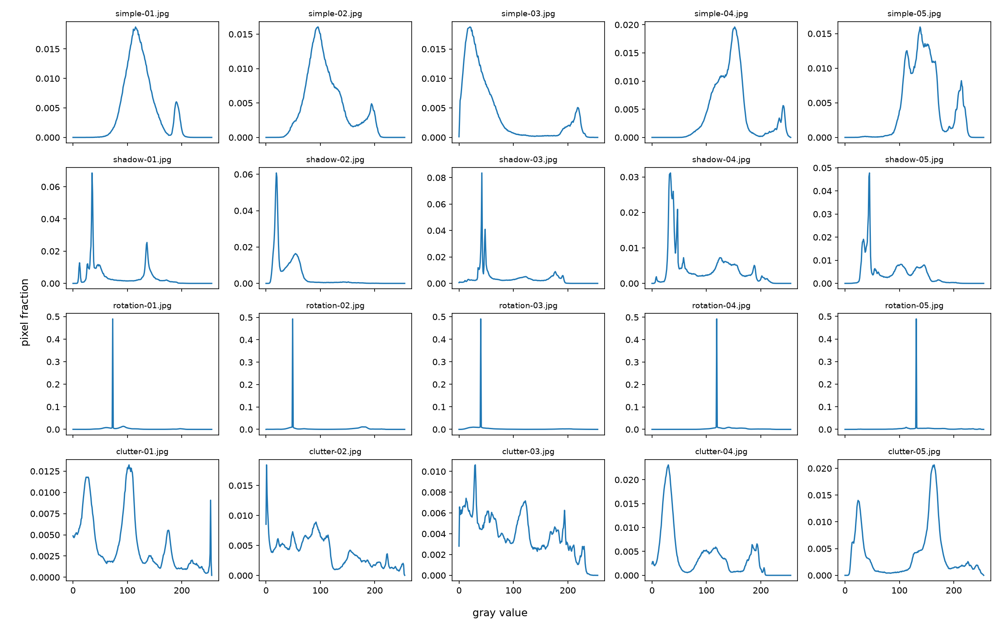
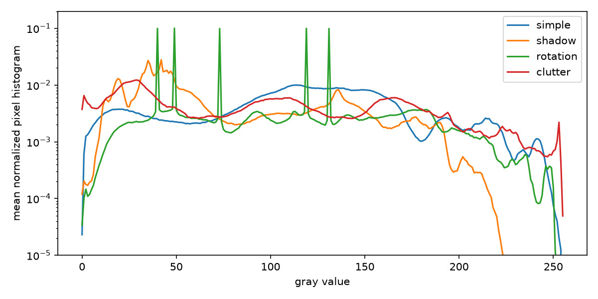

# 문서 스캐너

문서 사진의 검출/투시 변환을 구현하고 실제 이미지 조건별 성공과 실패를 분석합니다. NumPy 블러, 종횡비 보정과 PDF 출력을 포함합니다.

## 실행 환경

미션 전용 격리 환경에서 수행합니다. 실제 버전과 데이터 출처는 준비 후 기록합니다.

## 진행 상태

데이터 확보와 환경 준비 중입니다. 실제 실행 결과를 항목별로 추가합니다.

## 문서 사진

[DocUNet 원 소유자](https://www3.cs.stonybrook.edu/~cvl/docunet.html)가 공개한 표준 벤치마크의 실제 문서 사진을 확보했습니다. 직접 촬영 대안으로 사용하며 LMS의 cv19_test_images.zip과 같은 파일이라고 주장하지 않습니다.

```text
DocUNet original photos: 130
archive bytes: 344449749
SHA-256: ec226874d6845934c88b047c37e4e1a99cb2a8b9c42836739bc09015bcdc4405
ZIP CRC: PASS
```

원본은 별도로 보존하고 평가할 20장의 조건/파일명을 선정한 뒤 검출 결과를 확인합니다. HTTPS 배포 서버의 인증서 체인 오류가 있어 원 소유자 페이지에 게시된 원래 HTTP 주소에서 내려받았습니다.

## 스캐너 기본 구현

직접 구현한 좌표 순서, NumPy 블러의 두 방식, 투시 변환, 검출 실패와 파일 저장 경계를 확인했습니다. 마름모에서 같은 꼭짓점을 중복 선택하지 않도록 중심각 정렬과 일관된 시작점 규칙을 사용했습니다.

```text
$ python -m unittest discover -s tests -v
{"input_path": "/var/folders/d1/s_rf51vn1gd_08wtq55ss94r0000gn/T/tmpgb378phd/doc.png", "detected": true, "corners": [[118.0, 69.0], [491.0, 108.0], [452.0, 361.0], [89.0, 322.0]], "files": {"original": "/var/folders/d1/s_rf51vn1gd_08wtq55ss94r0000gn/T/tmpgb378phd/out/doc_original.png", "preprocessed": "/var/folders/d1/s_rf51vn1gd_08wtq55ss94r0000gn/T/tmpgb378phd/out/doc_preprocessed.png", "edges": "/var/folders/d1/s_rf51vn1gd_08wtq55ss94r0000gn/T/tmpgb378phd/out/doc_edges.png", "contours": "/var/folders/d1/s_rf51vn1gd_08wtq55ss94r0000gn/T/tmpgb378phd/out/doc_contours.png", "warped": "/var/folders/d1/s_rf51vn1gd_08wtq55ss94r0000gn/T/tmpgb378phd/out/doc_warped.png", "binary": "/var/folders/d1/s_rf51vn1gd_08wtq55ss94r0000gn/T/tmpgb378phd/out/doc_binary.png"}, "status": "ok"}
test_export_pdf_magic (test_scanner.ScannerTests.test_export_pdf_magic) ... ok
test_find_document_blank_failure (test_scanner.ScannerTests.test_find_document_blank_failure) ... ok
test_find_document_success (test_scanner.ScannerTests.test_find_document_success) ... ok
test_main_bad_args (test_scanner.ScannerTests.test_main_bad_args) ... ok
test_main_headless_success (test_scanner.ScannerTests.test_main_headless_success) ... ok
test_numpy_blur_loop_vectorized_equal_gray (test_scanner.ScannerTests.test_numpy_blur_loop_vectorized_equal_gray) ... ok
test_numpy_blur_loop_vectorized_equal_rgb (test_scanner.ScannerTests.test_numpy_blur_loop_vectorized_equal_rgb) ... ok
test_numpy_blur_matches_opencv_same_kernel_and_boundary (test_scanner.ScannerTests.test_numpy_blur_matches_opencv_same_kernel_and_boundary) ... ok
test_order_points_axis_aligned (test_scanner.ScannerTests.test_order_points_axis_aligned) ... ok
test_order_points_degenerate_rejected (test_scanner.ScannerTests.test_order_points_degenerate_rejected) ... ok
test_order_points_diamond (test_scanner.ScannerTests.test_order_points_diamond) ... ok
test_order_points_duplicate_rejected (test_scanner.ScannerTests.test_order_points_duplicate_rejected) ... ok
test_order_points_rotated_convex (test_scanner.ScannerTests.test_order_points_rotated_convex) ... ok
test_scan_image_not_found (test_scanner.ScannerTests.test_scan_image_not_found) ... ok
test_scan_image_saves_outputs (test_scanner.ScannerTests.test_scan_image_saves_outputs) ... ok
test_speed_test_has_measured_values (test_scanner.ScannerTests.test_speed_test_has_measured_values) ... ok
test_warp_document_outputs (test_scanner.ScannerTests.test_warp_document_outputs) ... ok

----------------------------------------------------------------------
Ran 17 tests in 1.755s

OK
```

## 평가 입력과 경계 주석

DocUNet의 서로 다른 실제 사진20장을 선택했습니다. 단순 배경5장, 그림자5장, 기울어짐5장, 복잡한 배경5장으로 구성했습니다. 그림자 그룹에는 알려진 강도의 부드러운 명암 변화를, 회전 그룹에는 평면 내55도 회전을 통제 변형으로 적용했습니다. 실제 촬영 카메라의3차원 각도를 알고 있다고 해석하지 않습니다. 원본 사진은 변경하지 않고 실습 사본에 변형했습니다.

검출기를 실행하기 전에 원본/변형 이미지를 보고 문서의 네 꼭짓점을 정규화 좌표로 주석하고, 경계 그림20장을 확인했습니다. 곡면 종이의 바깥 경계는 근사 사각형이며 이 주석의 한계를 보고서에서 구분합니다. 기하학적 검출은 주석과의IoU0.75 이상/정규화 꼭짓점RMSE0.04 이하로 측정하고, 실제 스캔본의 판독/왜곡 여부는 따로 검토합니다.

## 기본 설정의 실제 사진 평가

```text
$ python evaluate.py --cases data/cases --stages output/stages
{
  "parameters": {
    "blur_kernel": 5,
    "canny_low": 50,
    "canny_high": 150,
    "min_area_ratio": 0.08
  },
  "groups": {
    "clutter": {
      "tests": 5,
      "success": 1,
      "failure": 4,
      "success_rate": 0.2
    },
    "rotation": {
      "tests": 5,
      "success": 0,
      "failure": 5,
      "success_rate": 0.0
    },
    "shadow": {
      "tests": 5,
      "success": 1,
      "failure": 4,
      "success_rate": 0.2
    },
    "simple": {
      "tests": 5,
      "success": 2,
      "failure": 3,
      "success_rate": 0.4
    }
  },
  "success": 4,
  "tests": 20
}
```

이 수치는 사전 시각 주석에 대한 기하학적 검출 결과입니다. 네 꼭짓점 검출 여부만으로 휘어진 글씨가 펴졌다고 판단하지 않고 스캔본을 별도로 검토합니다.

## 후보 선택 개선

초기의 가장 큰 외곽 사각형 방식은 사진 테두리/책상/키보드와 문서를 혼동했습니다. 내부 윤곽도 비교하고 여러 근사 정밀도에서 후보를 만든 뒤 면적, 주변 대비, 밝기와 중심 위치를 함께 사용하도록 수정했습니다. 밝은 종이/중앙 문서에 유리한 규칙이며 검은 명함이나 주변의 다른 밝은 사각형에서는 한계가 있습니다.

```text
$ python evaluate.py --cases data/cases --min-area .02 --selection scored
{
  "parameters": {
    "blur_kernel": 5,
    "canny_low": 50,
    "canny_high": 150,
    "min_area_ratio": 0.02,
    "selection": "scored"
  },
  "groups": {
    "clutter": {
      "tests": 5,
      "success": 2,
      "failure": 3,
      "success_rate": 0.4
    },
    "rotation": {
      "tests": 5,
      "success": 4,
      "failure": 1,
      "success_rate": 0.8
    },
    "shadow": {
      "tests": 5,
      "success": 1,
      "failure": 4,
      "success_rate": 0.2
    },
    "simple": {
      "tests": 5,
      "success": 4,
      "failure": 1,
      "success_rate": 0.8
    }
  },
  "success": 11,
  "tests": 20
}
```

초기4/20과 개선11/20은 같은 사전 주석/같은20장에 대한 기하학적 비교입니다. 초기 소스는 a43c632이며 현재는 `--selection largest --min-area .08`로 비교 방식을 선택할 수 있습니다. 스캔본의 휘어진 글씨는 별도로 검토합니다.

## 원형 배경의 사각형 오검출 보완

원형 받침이 네 점으로 과도하게 근사되던 rotation-02를 확인했습니다. 근사 사각형/원 윤곽의 면적 비율이0.8 미만인 후보를 제거하자 문서 후보가 선택됐습니다. 원형 배경/잘못된 사각형/네 모서리 색의 방향 보존 검사를 추가해 총20개 검사가 통과했습니다.

| 조건 | 테스트 | 성공 | 실패 | 성공률 |
|---|---:|---:|---:|---:|
| simple | 5 | 4 | 1 | 80% |
| shadow | 5 | 1 | 4 | 20% |
| rotation | 5 | 5 | 0 | 100% |
| clutter | 5 | 2 | 3 | 40% |
| 전체 | 20 | 12 | 8 | 60% |

최종 기하 기준 성공은12/20입니다. 원본과 변환/이진화 결과를 모두 열어 확인했으며, 그림자 사진의 희미한 글자 소실과 종이의 곡률은 이 성공률과 별개로 남았습니다. 평면 내 회전을 보정해도 글씨를 의미상 정방향으로 회전하는 기능은 없으므로 일부 결과는90도 돌아가 있습니다.

## 밝기 분포와 실패 분석





전체 프레임의0~255 밝기 히스토그램을 각 이미지에서 정규화했습니다. 그림자 사진은 저명도 쪽으로 이동했습니다. simple-03도 어두운 카펫이 프레임 대부분을 차지하므로 전체 평균56.4를 종이 자체의 밝기로 해석하면 안 됩니다. 회전 그룹의 큰 피크는 확장 캔버스의 단색 패딩 영향을 포함합니다. 따라서 조건별 그래프는 장면/배경까지 포함한 분포이며 문서 마스크 안의 광량 측정이 아닙니다.

그림자5장은 같은 원본에 명암 변형을 적용하기 전후도 비교했습니다. 같은 설정에서 원본3/5가 성공했지만 그림자 추가 후1/5로 줄었습니다. shadow-04의 엣지 픽셀 비율은7.5%에서2.1%, shadow-05는6.4%에서2.9%로 감소했고 두 문서 모두 검출에 실패했습니다. Canny가 보는 기울기 대비가 약해지면서 경계가 끊기는 현상과 일치합니다. 원본에서도 실패한2장은 그림자만 실패 원인이라고 단정할 수 없습니다.

| 실패 사진 | 확인한 현상 | 조정/남은 한계 |
|---|---|---|
| simple-03 | 어두운 거친 바탕, 작은 컬러 달력의 외곽이 닫히지 않음 | 최종27개 설정 중12개에서는 경계를 찾음. 공통 설정에서는 실패 |
| shadow-01 | 손으로 든 영수증의 어두운 한쪽 경계가 소실 | 비교한27개 설정 모두 실패. 단순 임계값 변경으로 복구되지 않음 |
| shadow-04 | 그림자가 문서와 바탕의 경계를 약화 | 낮은 Canny에서 일부 복구되지만 다른 배경의 오검출 증가 |
| clutter-01 | 문서 전체 대신 글씨 왼쪽의 가느다란 사각 영역 선택 | IoU0.244. 면적/대비 규칙만으로 종이와 인쇄 구역을 구분하지 못함 |
| clutter-02 | 키보드 위 영수증의 곡면/주변 경계가 이어짐 | 비교한27개 설정 모두 실패. 사각형을 이루는 연결 경계가 부족 |
| clutter-03 | 영수증 대신 위쪽 파란 물체/상자의 경계를 선택 | 문서 주석과 IoU0. 대비가 강한 배경 후보가 우세 |

기하 검출에 성공한 simple-02/rotation-04도 페이지 중앙의 휘어진 글씨가 남았습니다. Homography는 하나의 평면을 직사각형으로 옮기므로 종이의 내부 곡면을 펴지 못합니다. shadow-02는 외곽을 찾았지만 이진화에서 옅은 글자가 사라졌습니다. 외곽 성공과 판독 품질은 같은 지표가 아닙니다.

## 파라미터와 규칙의 한계

블러3/5/9, Canny20:60/50:150/100:250, 최소 면적2%/5%/8%의27개 조합을 같은20장에 실행했습니다. 공통 최고는12/20이며 이미지마다 유리한 설정을 고르는 경우16/20입니다. 조사한 범위에서 모든 이미지를 성공시키는 설정은 없었습니다. 가능한 모든 파라미터의 부존재를 증명한 것은 아닙니다.

shadow-02는 blur3/Canny50:150/면적2%에서 성공하지만 clutter-01은 실패합니다. Canny100:250으로 바꾸면 clutter-01이 성공하고 shadow-02는 실패합니다. 실제 설정별/사진별 결과는 [비교 원시 결과](outputs/parameter-sweep-final.json)와 [집계](outputs/parameter-analysis-final.json)에 있습니다.

최대 외곽/면적 규칙4/20에서 내부 후보/주변 대비/밝기/중심성을 추가해11/20, 곡선의 과도한 네 점 근사를 거절해12/20으로 바뀌었습니다. 밝은 중앙 종이를 가정하므로 어두운 카드나 더 밝은 다른 사각형에서 실패할 수 있습니다. 새 규칙을 추가해도 별도의 예외가 생기는 것을 확인했습니다. 이20장은 개선에도 사용했으므로 독립적인 일반화 성능으로 제시하지 않습니다.

조명/배경이 다양한 경계와 문서 영역을 데이터로 학습하는 검출/분할은 배경의 강한 대비에 덜 의존할 수 있다는 가설을 세웠습니다. 곡면 복원과 그림자 제거는 외곽 검출 이후에도 별도 학습 목표와 품질 평가가 필요합니다. 여기서는 학습 기반 모델이나 OCR을 실행했다고 주장하지 않습니다.

## 데이터와 분석 재현

```bash
python prepare_data.py --download
python evaluate.py --cases data/cases --min-area .02 --output outputs/final-evaluation.json --stages output/stages
python evaluate.py --cases data/cases --sweep --output outputs/parameter-sweep-final.json
python analyze.py --cases data/cases --originals data/original
```

prepare_data는344MB 원본 ZIP과 선택한 사진의 SHA-256을 확인하고 필요한 사진20장/평가 사본20장을 추출합니다. 고정 명세의 source/transform/quad는 [평가 입력과 사전 주석](evaluation/cases.json)에 있습니다. 실제 준비 모듈로 만든 평가 JPEG20개가 기존 평가 입력과 바이트 단위로 일치했습니다. 원본 데이터는 저장소에 포함하지 않습니다. 초기 방식은 현재 버전에서 `--selection largest --min-area .08`로 비교할 수 있습니다.
